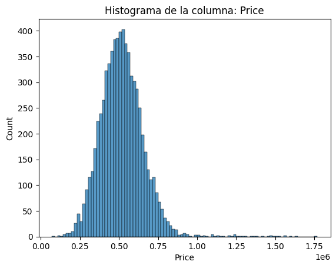

# Proyecto N-3: Inversión Inmobiliaria
### Predicción del precio de viviendas con Machine Learning supervisado

---

## Descripción

Modelo de **Regresión Lineal** que predice el precio de venta de una vivienda
a partir de sus características (tamaño, número de habitaciones, ubicación, tipo
de propiedad, etc.).

Este proyecto forma parte de una ruta de aprendizaje de Ciencia de Datos (Proyecto N-3)
y cubre el ciclo de vida completo de un proyecto de ML: entendimiento del negocio,
adquisición, limpieza, análisis exploratorio, modelado, evaluación y comunicación.

---

## Problema de negocio

Una agencia inmobiliaria tardaba semanas en tasar propiedades, con errores frecuentes
que le costaban clientes y comisiones. El objetivo era construir un sistema que
estimara el precio de una vivienda en minutos, con un error aceptable.

---

## Dataset

- **Fuente:** [House Price Prediction Dataset (Kaggle)](https://www.kaggle.com/datasets/abacilla/house-price-prediction-dataset)
- **Tamaño original:** 7.045 filas × 13 columnas
- **Variable objetivo:** `Price` (continua)
- **Suciedad real:** valores nulos, duplicados, categorías inconsistentes y outliers
  (no es un dataset de tutorial).

---

## Pipeline del proyecto

| Fase | Descripción | Documento |
|---|---|---|
| F-1 | Entendimiento del Negocio |
| F-2 | Adquisición de Datos |
| F-3 | Limpieza de Datos | 
| F-4 | Análisis Exploratorio (EDA) |
| F-5 | Modelado | 
| F-6 | Evaluación | 
| F-7 | Comunicación | 

---

## Tecnologías

- Python 3.8+
- Pandas, NumPy
- Matplotlib, Seaborn
- Scikit-Learn
- Google Colab

---

## Modelos entrenados y resultados

| Modelo | RMSE train | RMSE test | Error relativo (test) |
|---|---|---|---|
| **Regresión Lineal** | $32.776 | **$35.792** | **6.9%** |
| Árbol de Decisión | $0.00 | $55.628 | 10.7% |
| Random Forest | $15.667 | $40.893 | 7.9% |

**Modelo seleccionado:** Regresión Lineal.
- Justificación: mejor RMSE en test, estable en validación cruzada (RMSE CV promedio $33.693, σ $3.094).
- La relación `Price` ← X es esencialmente lineal, con `Area_Sqft` como predictor dominante.

---

## Visualizaciones clave

### Distribución de Price (sesgada a la derecha)

### Matriz de correlación

### Real vs Predicho

### Importancia de variables

---

## Conclusiones y limitaciones

- El modelo predice el precio con un error promedio del **6.9%** del precio medio del mercado.
- `Area_Sqft` es la variable más influyente: cada m² adicional suma ~$135.
- **Limitaciones:**
  - La Regresión Lineal no captura interacciones no lineales complejas.
  - Los precios extremos se predicen peor.
  - No se contemplan todas las variables posibles del mercado.

---

---

## Autor

**Carlos Muñoz**
- GitHub: (https://github.com/carlosdatasc)
- LinkedIn: (https://www.linkedin.com/in/juan-carlos-mu%C3%B1oz-meza-20a958322/?isSelfProfile=true)
